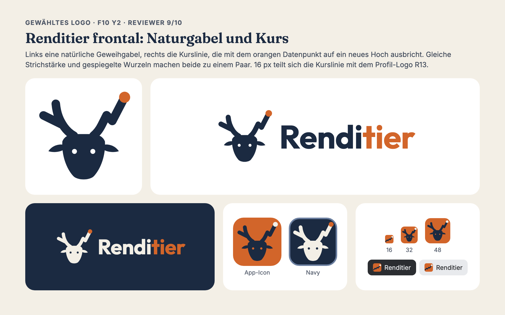
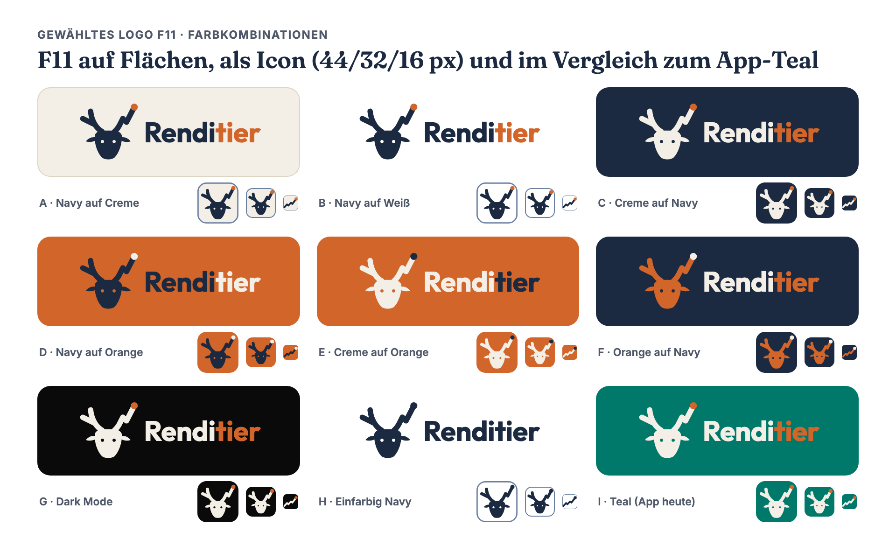
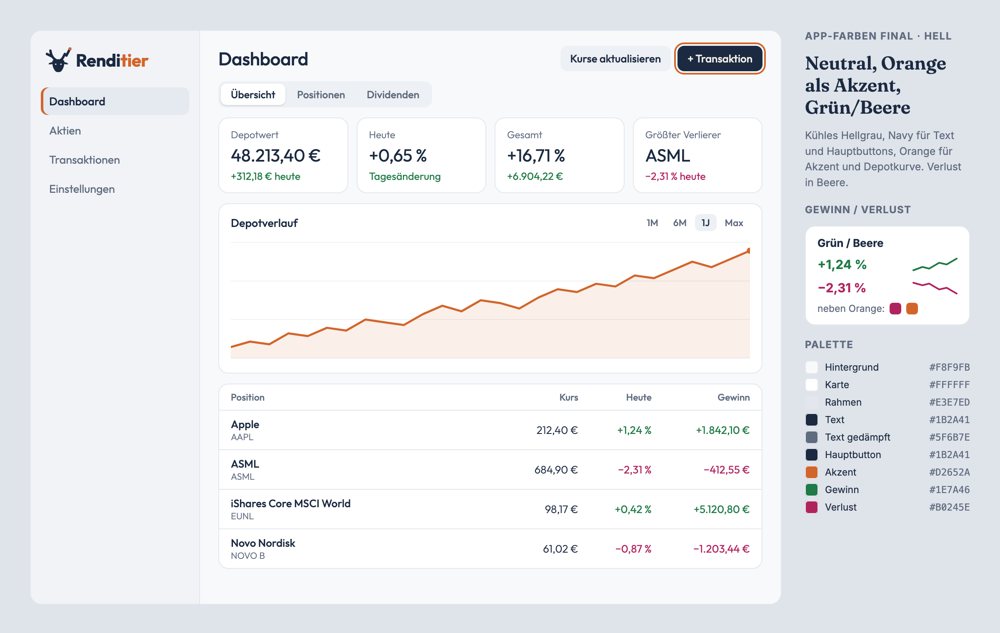
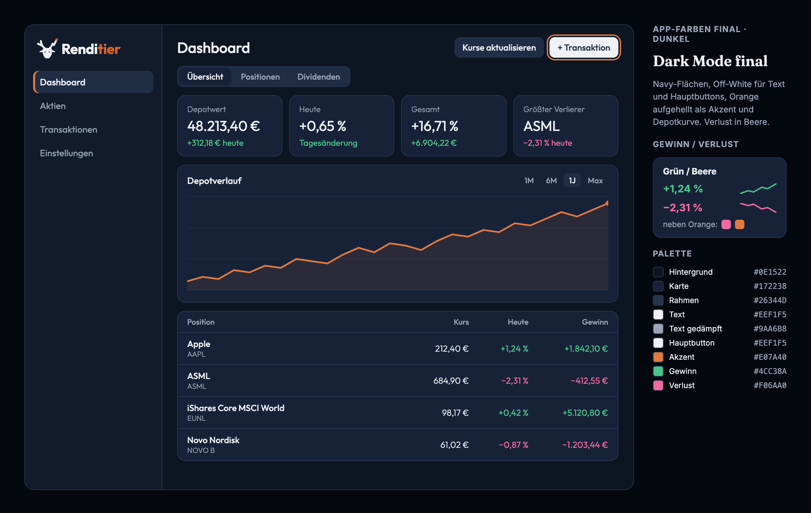

# Renditier style guide

**Renditier** is *Rendite* (return) plus *Rentier*: the reindeer, and the person who lives off their
investments. One word, capital R, never "RendiTier" or "Rendi-Tier".

## Logo

A reindeer head seen from the front. The left antler is a natural fork. The right antler is a price
line that breaks out to a new high, marked by the orange dot.

- The price line is a function: x strictly increases, no vertical or backward segments.
- The orange dot means *new high*. Never use orange to signal a loss (see [Gain and loss](#gain-and-loss)).
- Don't stretch, rotate, outline or recolour individual parts. Use the files below.

### Files

| File | Use |
| --- | --- |
| [`logo/renditier-mark.svg`](logo/renditier-mark.svg) | Mark on light backgrounds (navy, orange dot) |
| [`logo/renditier-mark-reversed.svg`](logo/renditier-mark-reversed.svg) | Mark on navy or other dark backgrounds (cream, orange dot) |
| [`logo/renditier-mark-mono.svg`](logo/renditier-mark-mono.svg) | One colour, takes `currentColor` (print, embossing, tiny monochrome UI) |
| [`logo/renditier-lockup.png`](logo/renditier-lockup.png) | Mark plus wordmark, light backgrounds |
| [`logo/renditier-lockup-reversed.png`](logo/renditier-lockup-reversed.png) | Mark plus wordmark, dark backgrounds |
| [`icons/icon.svg`](icons/icon.svg) | App icon (orange tile), 48 px and up |
| [`icons/icon-32.svg`](icons/icon-32.svg) | App icon tuned for 32 px (heavier strokes, bigger dot) |
| [`icons/favicon.svg`](icons/favicon.svg) | 16 px: only the price line survives at that size |
| [`icons/favicon.ico`](icons/favicon.ico) | 16, 32 and 48 px, each from its own drawing |
| `icons/icon-{96,192,512}.png` | PWA manifest icons |

The eyes in the mark are holes, so it works on any background colour. The lockups are PNG because
the wordmark is set in Outfit. A vector lockup needs the text converted to outlines (see
[migration](migration.md)).

### Sizes

| Size | Drawing |
| --- | --- |
| 48 px and up | Full mark |
| 32 px | `icon-32.svg`: same shapes, strokes 6.2 instead of 5.2 |
| 16 px | `favicon.svg`: the price line alone |

Keep clear space around the mark of at least the dot's diameter. In tiles and buttons, give the mark
at least the padding of the app icon.

## Colour

### Brand colours

| | Hex | Role |
| --- | --- | --- |
| Navy | `#1B2A41` | Mark, text, primary buttons |
| Orange | `#D2652A` | The dot, the "tier" in the wordmark, the one accent in the UI |
| Cream | `#F3EFE6` | Mark on dark backgrounds. Logo only, never a UI surface |

Combinations A to H are fine. Teal (I) belongs to the old app and goes away.

Orange is too light for small text: white on orange and navy on orange both stay below 4.5:1. Use
orange for marks, lines, focus rings and display type (the wordmark, 24 px bold and up), not for body
text or button labels.

### App palette

The UI uses neutral surfaces. Navy carries text and primary actions, orange is the accent (active
navigation item, focus ring, portfolio chart line and its end dot).

| Role | Light | Dark |
| --- | --- | --- |
| Background | `#F8F9FB` | `#0E1522` |
| Sidebar | `#F1F3F7` | `#121B2B` |
| Card, popover | `#FFFFFF` | `#172238` |
| Border, input | `#E3E7ED` | `#26344D` |
| Secondary, muted surface | `#EDF0F4` | `#1F2D45` |
| Active navigation item | `#E5E9F0` | `#1F2D45` |
| Text, primary button | `#1B2A41` | `#EEF1F5` |
| Primary button label | `#F8F9FB` | `#1B2A41` |
| Muted text | `#5F6B7E` | `#9AA6B8` |
| Accent, focus ring, chart line | `#D2652A` | `#E07A40` |

Dark surfaces are darkened navy, not neutral grey. Dark text is a neutral off-white, not cream.

### Gain and loss

| | Light | Dark |
| --- | --- | --- |
| Gain | `#1E7A46` | `#4CC38A` |
| Loss | `#B0245E` | `#F06AA0` |

Green and berry, not green and red: red sits too close to the brand orange, and orange means *new
high* in the logo. Amounts always carry their sign, so the colour is never the only signal.

All text pairs above reach at least 4.5:1 on their background.

## Typography

Outfit for everything, wordmark and UI. The wordmark stands out through weight and colour: 700
against at most 500 in the UI, and the orange "tier".

| Use | Weight |
| --- | --- |
| Wordmark | 700, letter spacing -0.01em, "Rendi" in navy (cream on dark), "tier" in orange |
| Titles, emphasis, active navigation, buttons | 500 |
| Numbers (amounts, prices, percentages, KPIs) | 400, always with tabular figures (`font-variant-numeric: tabular-nums`) |
| Navigation | 400 |
| Running text, labels | 300 |

Nothing in the UI goes above 500, so the wordmark keeps its weight to itself. At 700, the geometric
strokes of Outfit match the antler.

